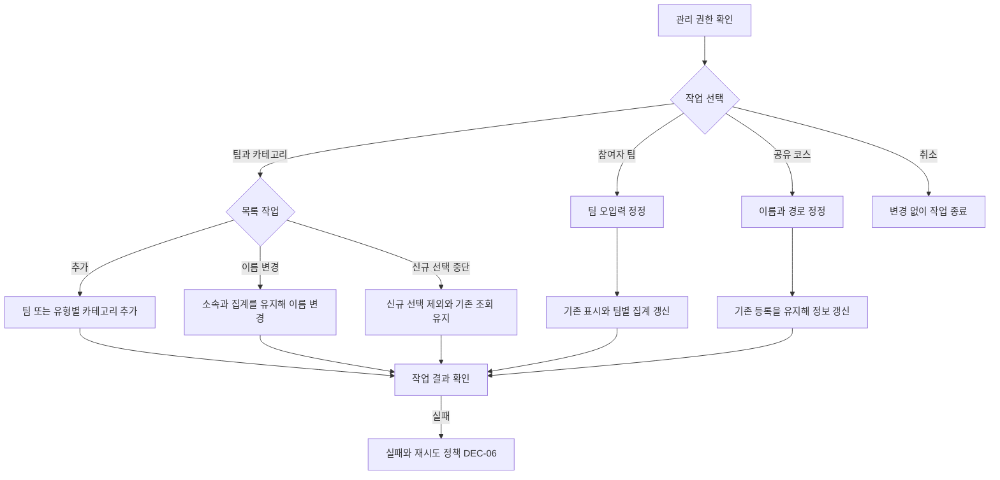
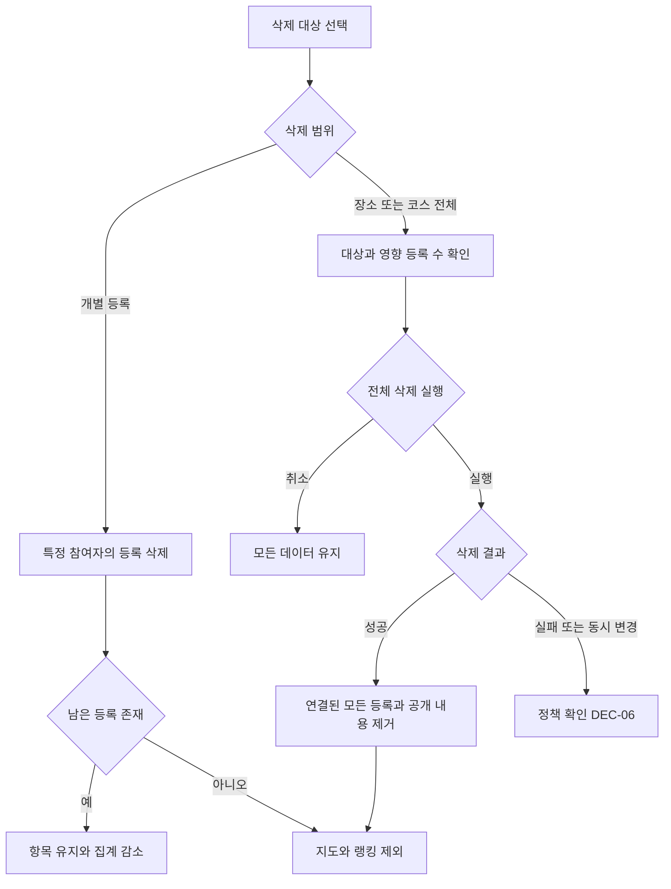

# 관리자 사용자 스토리와 화면 흐름

[전체 목차](../2-user-story.md) · [QA 상세](qa/admin.md) · [확정 결정](decisions.md)

이 문서의 화면은 기능 단위다. 별도 페이지·모달·패널 중 어떤 형태로 구현할지는 후속 화면 설계에서 정한다. 아래 분기 표는 요약이며, 준비 상태·실행 절차·기대 결과의 기준은 연결된 QA 항목이다.

## 사용자 스토리

### US-A-01

- **스토리:** 나는 행사에 맞는 팀과 카테고리를 준비하고 운영하고 싶다.
- **시작 조건:** 관리 권한 확보
- **흐름:** 추가·이름 변경·신규 선택 중단 → 참여 화면 확인
- **완료 조건:** 신규 선택 목록이 갱신되고 기존 데이터는 유지된다.
- **근거:** [PRD](../1-prd.md) §4, 7.

### US-A-02

- **스토리:** 나는 팀 오입력과 공유 코스의 잘못된 정보를 정정하고 싶다.
- **시작 조건:** 관리 권한과 정정 대상 확인
- **흐름:** 팀 또는 코스 정정 → 저장 → 참여·집계 확인
- **완료 조건:** 팀별 집계와 기존 표시가 변경 사항을 반영한다.
- **근거:** [PRD](../1-prd.md) §2, 4, 7.

### US-A-03

- **스토리:** 나는 잘못된 등록을 필요한 범위만큼 삭제하고 싶다.
- **시작 조건:** 관리 권한과 삭제 대상 확인
- **흐름:** 개별 또는 전체 대상 → 영향 확인 → 실행·취소
- **완료 조건:** 삭제 대상과 집계가 일치하고 취소 시 변화가 없다.
- **근거:** [PRD](../1-prd.md) §5, 7.

## 화면 명세

| 화면 ID | 화면·영역 | 진입 | 표시 정보 | 행동·이동 |
| --- | --- | --- | --- | --- |
| SC-A-01 | 팀·카테고리 관리 | 권한 있는 관리자 진입 | 팀·카테고리 목록, 카테고리 유형, 신규 선택 가능 여부 | 추가; 이름 변경; 신규 선택 중단 |
| SC-A-02 | 참여자·코스 정정 | 정정 대상 선택 | 참여자 현재 팀 또는 공유 코스 이름·경로 | 정정 → 저장 → 결과 확인 |
| SC-A-03 | 등록·항목 삭제 | 삭제 대상 선택 | 개별 등록; 장소·코스 전체 삭제 시 영향 등록 수 | 전체 삭제 확인 → 실행·취소; 숨김·복구 행동 없음 |

## 화면 분기와 QA 연결

| 분기 ID | 화면 | 스토리 | 조건·시나리오 | QA |
| --- | --- | --- | --- | --- |
| BR-A-01-01 | SC-A-01 | [US-A-01](admin.md#us-a-01) | 팀 추가·이름 변경 | [QA-A-01-01](qa/admin.md#qa-a-01-01) |
| BR-A-01-02 | SC-A-01 | [US-A-01](admin.md#us-a-01) | 카테고리 유형별 추가·이름 변경 | [QA-A-01-02](qa/admin.md#qa-a-01-02) |
| BR-A-01-03 | SC-A-01 | [US-A-01](admin.md#us-a-01) | 신규 선택 중단 | [QA-A-01-03](qa/admin.md#qa-a-01-03) |
| BR-A-01-04 | SC-A-01 | [US-A-01](admin.md#us-a-01) | 목록 관리 입력 경계 · [DEC-08](decisions.md#dec-08) | [QA-A-01-04](qa/admin.md#qa-a-01-04) |
| BR-A-01-05 | SC-A-01 | [US-A-01](admin.md#us-a-01) | 선택 중단된 팀의 기존 참여 · [DEC-08](decisions.md#dec-08) | [QA-A-01-05](qa/admin.md#qa-a-01-05) |
| BR-A-02-01 | SC-A-02 | [US-A-02](admin.md#us-a-02) | 팀 정정과 기존 집계 | [QA-A-02-01](qa/admin.md#qa-a-02-01) |
| BR-A-02-02 | SC-A-02 | [US-A-02](admin.md#us-a-02) | 공유 코스 정정 · [DEC-01](decisions.md#dec-01) | [QA-A-02-02](qa/admin.md#qa-a-02-02) |
| BR-A-02-03 | SC-A-02 | [US-A-02](admin.md#us-a-02) | 관리자 접근과 참여자 구분 · [DEC-09](decisions.md#dec-09) | [QA-A-02-03](qa/admin.md#qa-a-02-03) |
| BR-A-03-01 | SC-A-03 | [US-A-03](admin.md#us-a-03) | 개별 등록 삭제 | [QA-A-03-01](qa/admin.md#qa-a-03-01) |
| BR-A-03-02 | SC-A-03 | [US-A-03](admin.md#us-a-03) | 전체 삭제 영향 확인·취소 | [QA-A-03-02](qa/admin.md#qa-a-03-02) |
| BR-A-03-03 | SC-A-03 | [US-A-03](admin.md#us-a-03) | 장소·코스 전체 삭제 실행 | [QA-A-03-03](qa/admin.md#qa-a-03-03) |
| BR-A-03-04 | SC-A-03 | [US-A-03](admin.md#us-a-03) | 관리 작업 실패·동시 변경 · [DEC-06](decisions.md#dec-06) | [QA-A-03-04](qa/admin.md#qa-a-03-04) |

## 흐름도

그림은 주요 경로를 나타낸다. 연결된 분기 표와 QA에 입력 경계·오류·확정 정책이 더 상세히 기록돼 있다.

### F-A-01 목록 관리·정정

SC-A-01~02; BR-A-01 및 BR-A-02; 인증 세부는 DEC-09

### F-A-02 개별·전체 삭제

SC-A-03; BR-A-03-01~04; 동시 변경 DEC-06

## 확정된 관리 정책

사전 관리자 계정+서버 허용 목록을 사용하며, 만료/권한 상실 시 작업을 거절하고 초안을 유지한다. 목록명1~30자·유형별 중복 금지, 선택 재개 허용·카테고리 유형 고정이다. 중단된 팀의 기존 참여는 허용한다. 전체 삭제 영향이 달라졌으면 재확인하며 관리자 삭제 후 새 등록을 허용한다.
