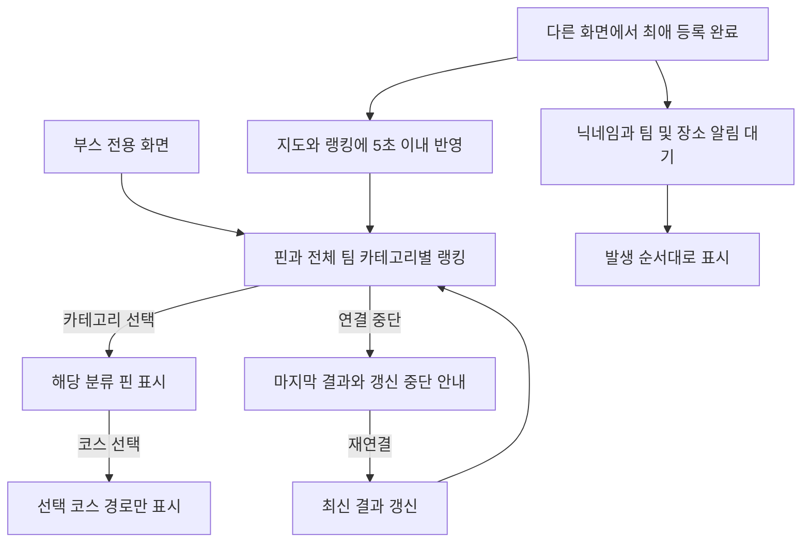

# 부스 관람자·운영자 사용자 스토리와 화면 흐름

[전체 목차](../2-user-story.md) · [QA 상세](qa/booth.md) · [결정 필요 사항](decisions.md)

이 문서의 화면은 기능 단위다. 별도 페이지·모달·패널 중 어떤 형태로 구현할지는 후속 화면 설계에서 정한다. 아래 분기 표는 요약이며, 준비 상태·실행 절차·기대 결과의 기준은 연결된 QA 항목이다.

## 사용자 스토리

### US-B-01

- **스토리:** 나는 부스에서 함께 완성되는 지도와 카테고리별 인기를 보고 싶다.
- **시작 조건:** PC Chrome의 부스 화면
- **흐름:** 지도·랭킹 관람 → 필터·코스 선택
- **완료 조건:** 전체 팀 기준 결과를 보고 선택한 코스만 펼친다.
- **근거:** [PRD](../1-prd.md) §5, 6.

### US-B-02

- **스토리:** 나는 동료들의 새로운 최애 등록을 현장에서 함께 확인하고 싶다.
- **시작 조건:** 부스 화면 열림
- **흐름:** 새 등록 발생 → 알림 대기 → 순서대로 표시
- **완료 조건:** 새 항목·기존 항목의 등록 모두 닉네임·팀·장소가 표시된다.
- **근거:** [PRD](../1-prd.md) §6, 8.

## 화면 명세

| 화면 ID | 화면·영역 | 진입 | 표시 정보 | 행동·이동 |
| --- | --- | --- | --- | --- |
| SC-B-01 | 부스 지도·랭킹 | 부스 전용 화면 열기 | 장소 핀, 전체 팀 기준 카테고리별 랭킹, 필터, 코스 시작점 | 카테고리 필터; 시작점 선택 → 선택 코스 경로 |
| SC-B-02 | 부스 상단 알림 | 최애 등록 완료 이벤트 | 닉네임·팀·장소 또는 코스 이름 | 등록 순서대로 표시; 대기와 지도·랭킹 갱신은 독립 |

## 화면 분기와 QA 연결

| 분기 ID | 화면 | 스토리 | 조건·시나리오 | QA |
| --- | --- | --- | --- | --- |
| BR-B-01-01 | SC-B-01 | [US-B-01](booth.md#us-b-01) | 부스 전용 구성 | [QA-B-01-01](qa/booth.md#qa-b-01-01) |
| BR-B-01-02 | SC-B-01 | [US-B-01](booth.md#us-b-01) | 카테고리 핀 필터 | [QA-B-01-02](qa/booth.md#qa-b-01-02) |
| BR-B-01-03 | SC-B-01 | [US-B-01](booth.md#us-b-01) | 산책코스 선택 | [QA-B-01-03](qa/booth.md#qa-b-01-03) |
| BR-B-02-01 | SC-B-02 | [US-B-02](booth.md#us-b-02) | 신규·기존 항목 등록 알림 | [QA-B-02-01](qa/booth.md#qa-b-02-01) |
| BR-B-02-02 | SC-B-02 | [US-B-02](booth.md#us-b-02) | 알림 대기와 실시간 결과 분리 | [QA-B-02-02](qa/booth.md#qa-b-02-02) |
| BR-B-02-03 | SC-B-02 | [US-B-02](booth.md#us-b-02) | 편집·삭제와 대기 알림 · [DEC-10](decisions.md#dec-10) | [QA-B-02-03](qa/booth.md#qa-b-02-03) |
| BR-B-02-04 | SC-B-02 | [US-B-02](booth.md#us-b-02) | 부스 재연결과 알림 재생 · [DEC-10](decisions.md#dec-10) | [QA-B-02-04](qa/booth.md#qa-b-02-04) |

## 흐름도

그림은 주요 경로를 나타낸다. 연결된 분기 표와 QA에 입력 경계·오류·미정 정책이 더 상세히 기록돼 있다.

### F-B-01 부스 관람과 등록 반영

SC-B-01~02; 모든 BR-B 분기; 연결 상태는 BR-N-02

