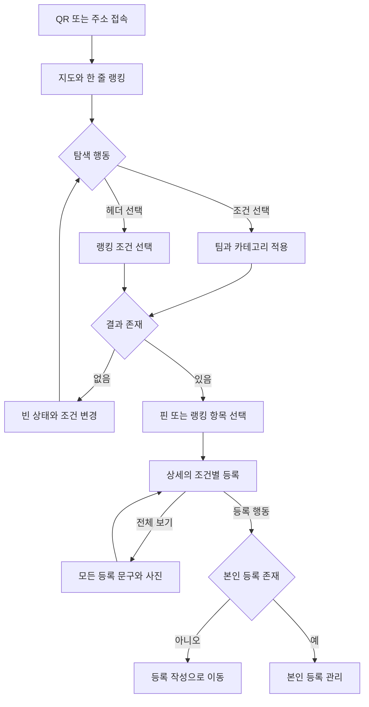
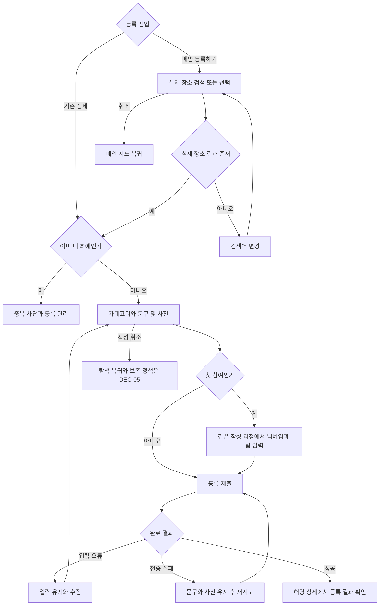
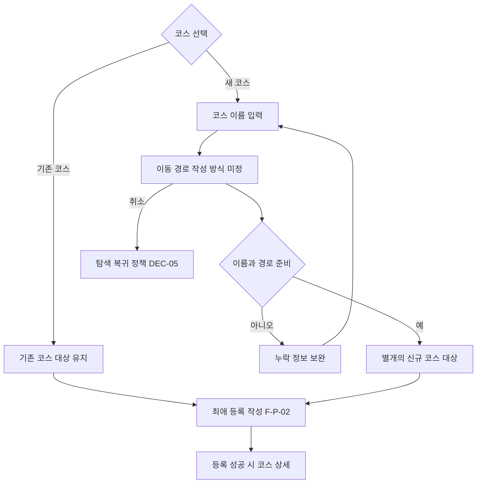
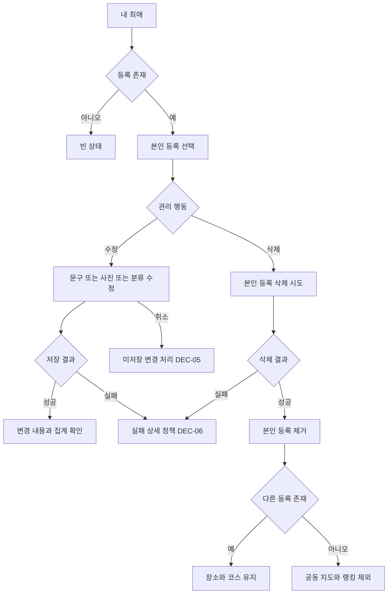
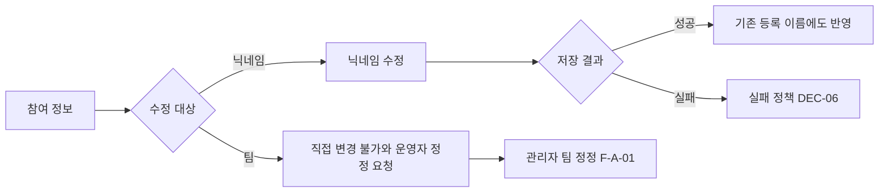

# 참여자 사용자 스토리와 화면 흐름

[전체 목차](../2-user-story.md) · [QA 상세](qa/participant.md) · [결정 필요 사항](decisions.md)

이 문서의 화면은 기능 단위다. 별도 페이지·모달·패널 중 어떤 형태로 구현할지는 후속 화면 설계에서 정한다. 아래 분기 표는 요약이며, 준비 상태·실행 절차·기대 결과의 기준은 연결된 QA 항목이다.

## 사용자 스토리

### US-P-01

- **스토리:** 나는 동료들의 최애를 찾기 위해 로그인 없이 지도를 둘러보고 싶다.
- **시작 조건:** QR·주소로 접속
- **흐름:** 지도 → 조건 선택 → 핀 선택
- **완료 조건:** 선택 조건에 맞는 항목과 횟수를 보고 상세로 이동한다.
- **근거:** [PRD](../1-prd.md) §1, 2, 5, 6.

### US-P-02

- **스토리:** 나는 팀과 카테고리에 맞는 인기 장소·코스를 알고 싶다.
- **시작 조건:** 메인 헤더 열람
- **흐름:** 한 줄 랭킹 → 랭킹 선택 → 조건 조합 → 항목 선택
- **완료 조건:** 최애 등록 수와 공동 순위를 기준으로 결과를 확인한다.
- **근거:** [PRD](../1-prd.md) §5, 6.

### US-P-03

- **스토리:** 나는 동료가 장소·코스를 좋아하는 이유를 보고 나도 최애로 등록하고 싶다.
- **시작 조건:** 지도·랭킹에서 항목 선택
- **흐름:** 상세 → 조건별·전체 등록 열람 → 나도 등록
- **완료 조건:** 문구·사진·작성자 정보를 확인하고 자신의 등록 여부에 맞는 행동을 한다.
- **근거:** [PRD](../1-prd.md) §2, 3, 4, 5.

### US-P-04

- **스토리:** 나는 실제 장소를 찾아 새로운 최애로 등록하고 싶다.
- **시작 조건:** 메인 하단 등록하기
- **흐름:** 검색·지도 장소 선택 → 등록 작성
- **완료 조건:** 실제 장소를 선택하고 중복 장소를 별도 항목으로 만들지 않는다.
- **근거:** [PRD](../1-prd.md) §3, 4.

### US-P-05

- **스토리:** 나는 짧은 문구와 사진으로 최애를 알리고 싶다.
- **시작 조건:** 장소·기존 코스 선택 완료
- **흐름:** 카테고리·문구·사진 및 첫 참여 정보 → 제출 → 상세
- **완료 조건:** 한 건만 등록되고 자신의 문구·사진과 증가한 횟수를 확인한다.
- **근거:** [PRD](../1-prd.md) §2, 3, 8.

### US-P-06

- **스토리:** 나는 좋아하는 산책 경로를 공유하거나 기존 코스를 내 최애로 등록하고 싶다.
- **시작 조건:** 산책코스 등록 또는 기존 코스 상세
- **흐름:** 이름·경로 준비 또는 기존 코스 선택 → 등록 작성
- **완료 조건:** 코스를 식별할 수 있고 동일 코스 선택은 함께 집계된다.
- **근거:** [PRD](../1-prd.md) §3, 4.

### US-P-07

- **스토리:** 나는 내 최애를 모아보고 내용을 수정하거나 삭제하고 싶다.
- **시작 조건:** 같은 브라우저에서 참여 정보 유지
- **흐름:** 내 최애 → 항목 → 수정·삭제 → 결과 확인
- **완료 조건:** 자신의 등록만 변경되고 지도·상세·조건별 집계가 일치한다.
- **근거:** [PRD](../1-prd.md) §3, 4, 5.

### US-P-08

- **스토리:** 나는 표시되는 닉네임을 고치고 팀 오입력의 정정을 요청하고 싶다.
- **시작 조건:** 참여 정보 유지
- **흐름:** 닉네임 수정 또는 운영자에게 팀 정정 요청
- **완료 조건:** 닉네임은 기존 등록에 반영되고 팀은 직접 바꾸지 못한다.
- **근거:** [PRD](../1-prd.md) §2, 7.

## 화면 명세

| 화면 ID | 화면·영역 | 진입 | 표시 정보 | 행동·이동 |
| --- | --- | --- | --- | --- |
| SC-P-01 | 메인 지도 | QR·주소 접속 또는 탐색 복귀 | 삼성역 인근 지도, 핀, 상단 한 줄 랭킹, 하단 등록하기 | 조건 선택 → 지도 갱신; 핀 → 상세; 헤더 → 랭킹; 등록하기 → 대상 선택 |
| SC-P-02 | 랭킹 보기 | 메인 헤더 선택 | 팀·카테고리 선택, 순위와 조건별 등록 횟수 | 항목 선택 → 상세; 종료 → 메인 |
| SC-P-03 | 장소·코스 상세 | 지도·랭킹·내 최애에서 선택 | 작성자 닉네임·팀·문구·사진, 등록 횟수, 코스 정보 | 조건별·전체 보기; 나도 등록 → 작성; 본인 등록 → 관리 |
| SC-P-04 | 등록 대상 선택 | 등록하기 | 실제 장소 검색·지도 선택 결과 | 실제 장소 선택 → 작성; 없음 → 다시 검색; 임의 위치·이름 등록 없음 |
| SC-P-05 | 최애 등록 작성 | 새 장소·코스 또는 기존 항목 선택 | 카테고리, 문구, 선택 사진; 첫 참여에 닉네임·팀 | 입력 → 제출 → 성공 시 상세; 오류 → 내용 유지·재시도 |
| SC-P-06 | 산책코스 준비 | 경로형 카테고리 등록 | 이름·경로 필수; 거리·시간은 제공 가능 시 표시 | 새 경로 준비 또는 기존 코스 선택 → 등록 작성; 경로 작성 조작은 DEC-01 |
| SC-P-07 | 내 최애·등록 수정 | 내 최애 진입 경로는 후속 화면 설계에서 배치 | 본인의 등록 목록과 내용 | 항목 열람; 문구·사진·분류 수정; 등록 삭제 |
| SC-P-08 | 참여 정보 관리 | 정보 관리 진입 경로는 후속 화면 설계에서 배치 | 닉네임과 현재 팀 | 닉네임 수정; 팀 직접 변경 불가; 운영자 정정 요청 |

## 화면 분기와 QA 연결

| 분기 ID | 화면 | 스토리 | 조건·시나리오 | QA |
| --- | --- | --- | --- | --- |
| BR-P-01-01 | SC-P-01 | [US-P-01](participant.md#us-p-01) | QR·주소 최초 접속 | [QA-P-01-01](qa/participant.md#qa-p-01-01) |
| BR-P-01-02 | SC-P-01 | [US-P-01](participant.md#us-p-01) | 팀·카테고리 조합 | [QA-P-01-02](qa/participant.md#qa-p-01-02) |
| BR-P-01-03 | SC-P-01 | [US-P-01](participant.md#us-p-01) | 지도 결과 없음 | [QA-P-01-03](qa/participant.md#qa-p-01-03) |
| BR-P-02-01 | SC-P-02 | [US-P-02](participant.md#us-p-02) | 공동 순위와 누적 집계 | [QA-P-02-01](qa/participant.md#qa-p-02-01) |
| BR-P-02-02 | SC-P-02 | [US-P-02](participant.md#us-p-02) | 랭킹 조건 변경과 빈 결과 | [QA-P-02-02](qa/participant.md#qa-p-02-02) |
| BR-P-02-03 | SC-P-02 | [US-P-02](participant.md#us-p-02) | 랭킹 표시 범위·동점 내부 순서 · [DEC-03](decisions.md#dec-03) | [QA-P-02-03](qa/participant.md#qa-p-02-03) |
| BR-P-03-01 | SC-P-03 | [US-P-03](participant.md#us-p-03) | 상세의 조건별·전체 보기 | [QA-P-03-01](qa/participant.md#qa-p-03-01) |
| BR-P-03-02 | SC-P-03 | [US-P-03](participant.md#us-p-03) | 나도 등록과 이미 등록한 상태 | [QA-P-03-02](qa/participant.md#qa-p-03-02) |
| BR-P-04-01 | SC-P-04 | [US-P-04](participant.md#us-p-04) | 실제 장소 선택과 기존 항목 재사용 | [QA-P-04-01](qa/participant.md#qa-p-04-01) |
| BR-P-04-02 | SC-P-04 | [US-P-04](participant.md#us-p-04) | 장소 검색 결과 없음·지역 밖 | [QA-P-04-02](qa/participant.md#qa-p-04-02) |
| BR-P-05-01 | SC-P-05 | [US-P-05](participant.md#us-p-05) | 첫 참여 정보와 등록 성공 | [QA-P-05-01](qa/participant.md#qa-p-05-01) |
| BR-P-05-02 | SC-P-05 | [US-P-05](participant.md#us-p-05) | 기존 참여와 등록 개수 | [QA-P-05-02](qa/participant.md#qa-p-05-02) |
| BR-P-05-03 | SC-P-05 | [US-P-05](participant.md#us-p-05) | 문구 길이 경계 | [QA-P-05-03](qa/participant.md#qa-p-05-03) |
| BR-P-05-04 | SC-P-05 | [US-P-05](participant.md#us-p-05) | 사진 장수 경계 | [QA-P-05-04](qa/participant.md#qa-p-05-04) |
| BR-P-05-05 | SC-P-05 | [US-P-05](participant.md#us-p-05) | 참여 정보·분류 누락 | [QA-P-05-05](qa/participant.md#qa-p-05-05) |
| BR-P-05-06 | SC-P-05 | [US-P-05](participant.md#us-p-05) | 닉네임 중복과 기기 기준 | [QA-P-05-06](qa/participant.md#qa-p-05-06) |
| BR-P-05-07 | SC-P-05 | [US-P-05](participant.md#us-p-05) | 카테고리를 바꾼 중복 등록 | [QA-P-05-07](qa/participant.md#qa-p-05-07) |
| BR-P-05-08 | SC-P-05 | [US-P-05](participant.md#us-p-05) | 통신·사진 실패와 재시도 | [QA-P-05-08](qa/participant.md#qa-p-05-08) |
| BR-P-05-09 | SC-P-05 | [US-P-05](participant.md#us-p-05) | 연속 제출·응답 유실 | [QA-P-05-09](qa/participant.md#qa-p-05-09) |
| BR-P-05-10 | SC-P-05 | [US-P-05](participant.md#us-p-05) | 작성 중 취소·뒤로·새로고침 · [DEC-05](decisions.md#dec-05) | [QA-P-05-10](qa/participant.md#qa-p-05-10) |
| BR-P-05-11 | SC-P-05 | [US-P-05](participant.md#us-p-05) | 문자·사진 세부 검증 · [DEC-04](decisions.md#dec-04) | [QA-P-05-11](qa/participant.md#qa-p-05-11) |
| BR-P-05-12 | SC-P-05 | [US-P-05](participant.md#us-p-05) | 작성 중 대상 변경 · [DEC-06](decisions.md#dec-06) | [QA-P-05-12](qa/participant.md#qa-p-05-12) |
| BR-P-06-01 | SC-P-06 | [US-P-06](participant.md#us-p-06) | 신규 코스 필수 정보 · [DEC-01](decisions.md#dec-01) | [QA-P-06-01](qa/participant.md#qa-p-06-01) |
| BR-P-06-02 | SC-P-06 | [US-P-06](participant.md#us-p-06) | 기존 코스와 유사 신규 코스 · [DEC-01](decisions.md#dec-01) | [QA-P-06-02](qa/participant.md#qa-p-06-02) |
| BR-P-07-01 | SC-P-07 | [US-P-07](participant.md#us-p-07) | 내 최애 목록과 빈 상태 | [QA-P-07-01](qa/participant.md#qa-p-07-01) |
| BR-P-07-02 | SC-P-07 | [US-P-07](participant.md#us-p-07) | 문구·사진 수정 | [QA-P-07-02](qa/participant.md#qa-p-07-02) |
| BR-P-07-03 | SC-P-07 | [US-P-07](participant.md#us-p-07) | 카테고리 수정과 필터 이동 | [QA-P-07-03](qa/participant.md#qa-p-07-03) |
| BR-P-07-04 | SC-P-07 | [US-P-07](participant.md#us-p-07) | 본인 등록 삭제·마지막 등록 | [QA-P-07-04](qa/participant.md#qa-p-07-04) |
| BR-P-07-05 | SC-P-07 | [US-P-07](participant.md#us-p-07) | 공유 코스 작성자의 등록 삭제 | [QA-P-07-05](qa/participant.md#qa-p-07-05) |
| BR-P-07-06 | SC-P-07 | [US-P-07](participant.md#us-p-07) | 다른 참여자의 관리 권한 | [QA-P-07-06](qa/participant.md#qa-p-07-06) |
| BR-P-07-07 | SC-P-07 | [US-P-07](participant.md#us-p-07) | 삭제 후 재등록·삭제 취소 · [DEC-07](decisions.md#dec-07) | [QA-P-07-07](qa/participant.md#qa-p-07-07) |
| BR-P-08-01 | SC-P-08 | [US-P-08](participant.md#us-p-08) | 닉네임 변경 | [QA-P-08-01](qa/participant.md#qa-p-08-01) |
| BR-P-08-02 | SC-P-08 | [US-P-08](participant.md#us-p-08) | 팀 직접 변경 불가 | [QA-P-08-02](qa/participant.md#qa-p-08-02) |
| BR-P-08-03 | SC-P-08 | [US-P-08](participant.md#us-p-08) | 참여 정보 상실 · [DEC-11](decisions.md#dec-11) | [QA-P-08-03](qa/participant.md#qa-p-08-03) |

## 흐름도

그림은 주요 경로를 나타낸다. 연결된 분기 표와 QA에 입력 경계·오류·미정 정책이 더 상세히 기록돼 있다.

### F-P-01 탐색·랭킹·상세

SC-P-01~03; BR-P-01-01~03, BR-P-02-01~03, BR-P-03-01~02

### F-P-02 장소·기존 항목 등록

SC-P-03~05; 입력·실패 검증 BR-P-05-01~12; 이탈 상세 정책 DEC-05

### F-P-03 산책코스 등록

SC-P-06 → SC-P-05; BR-P-06-01~02; 미정 조작은 DEC-01

### F-P-04 내 최애 수정·삭제

SC-P-07; BR-P-07-01~06; 개인 삭제 취소 UX는 DEC-07

### F-P-05 참여 정보 수정

SC-P-08; BR-P-08-01~03; 관리자 정정 F-A-01

